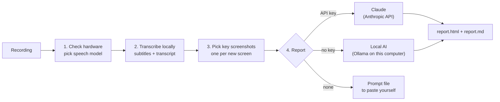

# Recall - Meeting Notes

Turn a recorded call into **subtitles, a transcript, key screenshots and a written meeting report**, by dropping the video on an icon.

The report has a summary, a TL;DR, system diagrams, context, action items per participant, requirements, an illustrated walkthrough, a glossary and open questions.

- **Private by design.** Speech recognition and screenshot picking run on your own computer. The video never leaves your machine.
- **Claude or local AI.** With an Anthropic API key, Claude writes the report from the transcript and a selection of screenshots. Without a key, a free AI model can write it on your computer, so nothing is sent anywhere.
- **Windows and macOS.** It uses an NVIDIA graphics card or an Apple Silicon GPU when you have one, and the processor otherwise.

---

## Contents

1. [What you need](#1-what-you-need)
2. [Download Recall](#2-download-recall)
3. [Install on Windows](#3-install-on-windows)
4. [Install on macOS](#4-install-on-macos)
5. [Make your first report](#5-make-your-first-report)
6. [Choose who writes the report](#6-choose-who-writes-the-report)
7. [What you get](#7-what-you-get)
8. [Keep private things out of the report](#8-keep-private-things-out-of-the-report)
9. [Tips](#9-tips)
10. [Command line](#10-command-line)
11. [Settings file](#11-settings-file)
12. [Troubleshooting](#12-troubleshooting)
13. [Update or uninstall](#13-update-or-uninstall)
14. [How it works](#14-how-it-works)
15. [For developers](#15-for-developers)

---

## 1. What you need

| | Windows | macOS |
| --- | --- | --- |
| System | Windows 10 or 11 | macOS 14 or newer (tested on macOS 26), Apple Silicon (M1 or later) or Intel |
| Memory | 8 GB RAM, 16 GB recommended | 8 GB, 16 GB recommended |
| Disk space | about 5 GB (10+ GB with the local AI) | about 4 GB (10+ GB with the local AI) |
| Internet | for the install, and for Claude reports | for the install, and for Claude reports |
| Faster with | an NVIDIA graphics card | Apple Silicon |

The setup downloads the heavy parts once: Python libraries (about 1.5 GB), NVIDIA libraries on Windows with an NVIDIA card (about 1 GB), and the speech model on the first run (about 1.6 GB). The optional local AI adds 2 to 20 GB, depending on your computer.

For a Claude report you also need an **Anthropic API key** (see [section 6](#6-choose-who-writes-the-report)). You don't need one to try Recall.

---

## 2. Download Recall

**With Git:**

```bash
git clone https://github.com/hanzlasajid/recall-meeting-notes.git recall
```

**Without Git:** on the GitHub page click **Code → Download ZIP**, unzip it, and rename the folder `recall-meeting-notes-main` to `recall`.

Put the folder somewhere permanent, for example `C:\Tools\recall` on Windows or `~/Applications/recall` on a Mac. Recall runs from this folder, so don't move it after setup (if you do, run the setup again).

---

## 3. Install on Windows

1. Open the `recall` folder.
2. Double-click **`setup_windows.bat`**.
   - If Windows shows *"Windows protected your PC"*, click **More info → Run anyway**.
3. A black window shows the progress. The setup:
   - installs Python 3.12 if you don't have it (with `winget`; if it asks you to accept terms, type **Y** and press Enter)
   - creates a private Python environment in the `.venv` folder and installs the libraries
   - installs the NVIDIA CUDA libraries if you have an NVIDIA card (about 1 GB)
   - puts a **Recall** shortcut on your desktop
4. At the end it shows your hardware and the speech model it will use, for example:
   ```
   Graphics:   NVIDIA RTX PRO 1000, 8 GB - usable for transcription
   Recommended: cuda:large-v3-turbo
   ```
5. Press any key to close the window.

This takes 5-15 minutes, depending on your internet connection. You only do it once.

---

## 4. Install on macOS

1. Open **Terminal** (press ⌘ Space, type *Terminal*, press Enter).
2. Type `cd ` (with a space), drag the `recall` folder onto the Terminal window, and press Enter.
3. Run:
   ```bash
   bash setup_mac.command
   ```
   You only need to type this once. After that you can double-click the `.command` files.
4. The setup:
   - uses your Python 3.10 or newer, or installs Python 3.12 with [Homebrew](https://brew.sh) if you have none
   - creates `.venv` and installs the libraries; on Apple Silicon this includes `mlx-whisper`, which runs on the Mac's GPU
   - builds **Recall.app** in the folder
   - shows your hardware and the speech model it will use
5. Press Enter to close.

**Use the Dock.** Drag `Recall.app` to the Dock. Keep the app itself in the `recall` folder, because it runs the tool from there.

**Settings window.** Recall shows its settings in a small window. That needs Python with Tk: the [python.org](https://www.python.org/downloads/macos/) installer includes it, and with Homebrew Python run `brew install python-tk@3.12`, then the setup again. Without Tk, Recall asks the same questions in Terminal.

**"Unidentified developer"?** Right-click `Recall.app` (or the `.command` file), choose **Open**, then **Open** again. You only need to do this once.

---

## 5. Make your first report

### Step 1: Start Recall with a recording

Do one of these:

- **Drag** a recording onto the **Recall** desktop shortcut (Windows) or **Recall.app** (Mac). You can drop several files at once; they run one after the other.
- **Double-click** the shortcut or app, and choose the recording in the file picker. It opens in your **Videos** folder (Windows) or **Movies** folder (Mac).

Recall reads `.mp4`, `.mkv`, `.mov`, `.m4v`, `.webm`, `.avi` and `.wmv` videos. It also takes audio files (`.mp3`, `.m4a`, `.wav`, `.ogg`, `.flac`), which give you everything except screenshots.

**The first time on a Mac**, macOS asks whether *"Recall" may control "Terminal"*. Click **Allow**. Recall uses a Terminal window to show its progress.

### Step 2: Check the settings

A window opens:

| Setting | What to do |
| --- | --- |
| **This computer** | Shows your processor, memory and graphics card. Nothing to do |
| **Transcription model** | The best model for your computer is already selected. Pick a smaller one if you're in a hurry, or a larger one for better accuracy |
| **Language** | Leave empty to detect it automatically, or type a code such as `en` or `de` |
| **Names and terms** | Optional. Type names and jargon that speech recognition might get wrong, separated by commas, e.g. `Kubernetes, Grafana, Priya, Q3 roadmap` |
| **Meeting report** | Who writes the report: Claude Sonnet, Claude Opus, Local AI, or none. See [section 6](#6-choose-who-writes-the-report) |
| **Anthropic API key** | Paste your key for a Claude report. Tick **Remember the key** so you don't have to paste it again |
| **Reuse the transcript and screenshots** | Only shown if you ran this recording before. Ticked: Recall skips straight to the report |

Click **Start**.

### Step 3: Wait

The Terminal (Mac) or console window (Windows) shows three steps:

```
Step 1/3  Transcribing with large-v3-turbo on Apple GPU
Step 2/3  Picking key screenshots
Step 3/3  Writing the meeting report
Done in 6.2 min. Everything is in: /Users/you/Movies/call_notes
```

How long it takes depends on the recording and your computer. For example, on a laptop with an 8 GB NVIDIA RTX PRO 1000, a 47-minute call took about 4 minutes to transcribe on the GPU, or 9 minutes on the processor. Screenshots took about 1 minute. The first run takes longer, because it downloads the speech model.

### Step 4: Read the report

When it's done, `report.html` opens in your browser. All files are in a folder next to the video, named after it, e.g. `team call_notes`. See [section 7](#7-what-you-get).

---

## 6. Choose who writes the report

| Option | Cost | Privacy | Quality | Needs |
| --- | --- | --- | --- | --- |
| **Claude Sonnet** (default) | a few cents to tens of cents per call | transcript and up to 40 screenshots are sent to Anthropic | very good | API key |
| **Claude Opus** | more than Sonnet | same as Sonnet | best, deepest analysis | API key |
| **Local AI** | free | nothing leaves your computer | good, less detailed | 2-20 GB download, once |
| **No AI report** | free | nothing is sent | you paste the prompt into Claude yourself | nothing |

### With Claude (API key)

1. Go to [console.anthropic.com](https://console.anthropic.com/), sign in, and add credit under **Billing**.
2. Open **API keys → Create key**, give it a name, and copy it.
3. Paste it into the **Anthropic API key** field and tick **Remember the key on this computer**.

The key is saved in `~/.recall/config.json`, readable only by you. If you prefer, set the `ANTHROPIC_API_KEY` environment variable instead.

A 45-minute call with 40 screenshots is about 60-70k input tokens. Check the current prices on Anthropic's pricing page.

### With the local AI (no key)

Pick **Local AI on this computer**, or press **Start** without a key. Recall then asks:

- **Yes**: write the report with a local AI model.
- **No**: skip the report and only save a prompt file (see below).
- **Cancel**: go back and enter a key.

The first time, Recall shows what it needs to install and how big it is, and asks before installing anything:

1. **[Ollama](https://ollama.com)**, the free app that runs AI models on your computer. Recall installs it with `winget` on Windows or Homebrew on macOS.
2. A **vision model** that can read the screenshots, picked for your computer:

| Your computer | Local model | Download |
| --- | --- | --- |
| Mac with 40 GB+ memory, or NVIDIA card with 24 GB+ | `qwen3-vl:30b-a3b-instruct` | 20 GB |
| Mac with 16-32 GB, or NVIDIA card with 6 GB+ and 16 GB RAM | `qwen3-vl:8b-instruct` | 6.2 GB |
| Smaller Mac or graphics card, or processor only with 16 GB RAM | `qwen3-vl:4b-instruct` | 3.3 GB |
| Less memory | `qwen3-vl:2b-instruct` | 1.9 GB |

After that, local reports need no internet at all. Measured on a MacBook with an M4 Pro and 24 GB: the first run took 6.5 minutes, including the 6.2 GB download. A short test call's report took under a minute. Longer calls take longer.

If the automatic install isn't possible (no Homebrew on the Mac, no winget on Windows), Recall says so and saves the prompt file instead. Install Ollama from [ollama.com/download](https://ollama.com/download) and run Recall again.

To use a different Ollama model, see [section 11](#11-settings-file).

### Without any AI (prompt file)

Choose **No AI report**. You still get the subtitles, transcript and screenshots, plus `analysis_prompt.md`. To get the report:

1. Open [claude.ai](https://claude.ai) and start a new chat.
2. Paste the contents of `analysis_prompt.md`.
3. Attach the most important screenshots from the `frames` folder.
4. Send. Claude writes the same report.

---

## 7. What you get

Everything is in the `<video name>_notes` folder next to the video:

| File | What it is |
| --- | --- |
| `report.html` | The meeting report with the screenshots built in. Open it in any browser, or send it as a single file |
| `report.md` | The same report in Markdown, to paste into Confluence, Notion, GitHub and so on |
| `transcript.txt` | The transcript, one timestamped line per sentence |
| `subtitles.srt` | Subtitles. A copy is also saved next to the video, so VLC and most players load them automatically |
| `frames/` | One screenshot per screen that was shown, named by time, e.g. `f012_00-05-51.jpg` |
| `frames.md` | Each screenshot with what was said while it was on screen |
| `analysis_prompt.md` | The full prompt, for pasting into Claude yourself |
| `transcript.json`, `frames.json` | Data Recall reuses when you run the same recording again |

### The report

1. **Title**, with the date, length and participants
2. **Summary**: what the call was about, in a few sentences
3. **TL;DR**: the key points as a short list
4. **System diagram**: only when the call explains a system or data flow
5. **Context**: background, with tables where useful
6. **Action items**: grouped by person, as checkboxes, with the time they were mentioned
7. **Requirements & details**
8. **Walkthrough**: the call phase by phase, with a screenshot for each phase
9. **Glossary**: terms and abbreviations
10. **Open questions**

To change the format, edit `recall/report_prompt.md`.

---

## 8. Keep private things out of the report

Screen recordings often catch things that shouldn't be shared, like a chat pop-up, an email preview or an incoming personal call. Before a report goes to Claude, you can remove them:

1. Run Recall with **No AI report** (or Local AI).
2. Open the `frames` folder and delete every screenshot you don't want to share.
3. Run Recall again on the same recording. Tick **Reuse the transcript and screenshots** and choose Claude.

Recall skips the screenshots you deleted, and transcription doesn't run again.

---

## 9. Tips

- **Wrong names in the transcript?** Add them under *Names and terms*, untick **Reuse**, and run again.
- **Report only.** To try another report model on the same recording, run it again with **Reuse** ticked. Only the report is written again.
- **Start from scratch.** Untick **Reuse**, or use `--fresh` on the command line.
- **Several recordings.** Drop them all at once. Recall asks for settings for each one, then runs them in turn.
- **Faster runs.** Pick a smaller transcription model. `small` is fine for clear audio.
- **Settings are remembered.** Language, names and terms, and report choice are kept for next time.

---

## 10. Command line

Everything in the window is also available on the command line. Run these in the `recall` folder:

```bash
# Windows:  .venv\Scripts\python -m recall ...
# macOS:    .venv/bin/python -m recall ...

python -m recall --hardware                       # show hardware and recommended models
python -m recall call.mp4                         # settings window, then run
python -m recall call.mp4 --no-gui                # recommended settings, no questions
python -m recall call.mp4 --model cpu:small       # choose the transcription model
python -m recall call.mp4 --report opus           # sonnet | opus | local | none
python -m recall call.mp4 --report local          # local AI report (installs Ollama and the model if needed)
python -m recall call.mp4 --language en           # skip language detection
python -m recall call.mp4 --fresh                 # redo transcript and screenshots
python -m recall a.mp4 b.mp4 c.mp4 --no-gui       # several files
```

Model keys look like `cuda:large-v3-turbo` (NVIDIA), `mlx:large-v3-turbo` (Apple Silicon) or `cpu:medium` (processor). `--hardware` lists the ones your computer can use.

With `--no-gui` and no API key, Recall writes no report unless you add `--report local`. It never installs anything without being asked.

---

## 11. Settings file

Recall keeps your choices in `~/.recall/config.json` (`C:\Users\<you>\.recall\config.json` on Windows):

| Key | Default | Meaning |
| --- | --- | --- |
| `api_key` | `""` | Anthropic API key, only stored if you tick *Remember* |
| `report_model` | `"sonnet"` | `sonnet`, `opus`, `local` or `none` |
| `language` | `""` | empty = detect automatically, or e.g. `"en"` |
| `vocabulary` | `""` | names and terms to spell correctly |
| `local_model` | `""` | Ollama model for local reports; empty = pick from the hardware. Any Ollama vision model works, e.g. `"gemma4:12b"` |
| `max_images` | `40` | screenshots sent to Claude |
| `max_frames` | `70` | most screenshots kept per recording |
| `reuse` | `true` | tick *Reuse* by default |

---

## 12. Troubleshooting

| Problem | What to do |
| --- | --- |
| Windows: "Windows protected your PC" | Click **More info → Run anyway** |
| Windows: Python install stops and waits | `winget` is asking you to accept its terms: click the window, type **Y**, press Enter |
| Mac: "unidentified developer" | Right-click the app or `.command` file → **Open → Open** |
| Mac: `.command` won't open, "permission denied" | Run `bash setup_mac.command` once in Terminal; it makes the scripts executable |
| Mac: nothing happens when you drop a file | Check **System Settings → Privacy & Security → Automation** and allow Recall to control Terminal |
| Mac: questions appear in Terminal instead of a window | Your Python has no Tk. Run `brew install python-tk@3.12` (Homebrew Python) or install Python from python.org, then run the setup again |
| "GPU transcription failed ... falling back to the processor" | Run the setup again (it reinstalls the NVIDIA libraries) and update your graphics driver. Recall still finishes, just slower |
| Graphics card shows "not usable" | Same as above. On Apple Silicon, check that the setup installed `mlx-whisper` |
| Names spelled wrong | Add them under *Names and terms* and run again with **Reuse** unticked |
| "The local report failed" | Open the Ollama app once, or install it from [ollama.com/download](https://ollama.com/download), then run again with **Reuse** ticked |
| Local report is very slow | Your computer is running the model on the processor. Use a smaller model (`"local_model": "qwen3-vl:2b-instruct"`) or a Claude key |
| Diagrams show as code in `report.html` | The diagrams are drawn by a script from the internet. Open the report while online |
| Claude: "authentication error" | Check the API key, and that your Anthropic account has credit |
| Moved the folder and now it fails | Run the setup again in the new place |

---

## 13. Update or uninstall

**Update:** in the `recall` folder run `git pull` (or download the ZIP again and replace the files, keeping `.venv`), then run the setup again.

**Uninstall:**

1. Delete the `recall` folder.
2. Delete the **Recall** desktop shortcut (Windows).
3. Optional: delete `~/.recall` (your settings and saved key).
4. Optional: delete the downloaded speech models in `~/.cache/huggingface/hub` (the `whisper` folders).
5. Optional, if you used the local AI: uninstall Ollama (Windows: **Settings → Apps**; Mac: `brew uninstall --cask ollama-app`). Its models are in `~/.ollama/models`.

---

## 14. How it works



1. **Hardware check.** Recall reads your processor, memory and graphics card, and picks the strongest speech model that runs well.
2. **Transcription** with [Whisper](https://github.com/openai/whisper), on your computer:
   - NVIDIA graphics card: [faster-whisper](https://github.com/SYSTRAN/faster-whisper) on the GPU
   - Apple Silicon: [mlx-whisper](https://github.com/ml-explore/mlx-examples/tree/main/whisper) on the Mac's GPU
   - otherwise: faster-whisper on the processor

   Subtitles use word timings: each one ends after a sentence, or at two lines of 42 characters or six seconds at most.
3. **Screenshots.** Recall compares the video once per second, finds every point where the shared screen changes, waits until scrolling stops, and saves one screenshot. Each screenshot is matched with what was said while it was on screen.
4. **Report.** The AI reads the transcript and the screenshots. On-screen text such as window titles, file names and participant names is used to correct words that speech recognition misheard.

### Which speech model it picks

| Your computer | Model | Accuracy |
| --- | --- | --- |
| NVIDIA card with 10 GB+ | `large-v3` on the GPU | best |
| NVIDIA card with 2.5-10 GB | `large-v3-turbo` on the GPU | near-best |
| Apple Silicon with 8 GB+ | `large-v3-turbo` on the Apple GPU | near-best |
| No usable GPU, 16 GB+ RAM, 8+ cores | `medium` on the processor | good |
| No usable GPU, 8 GB+ RAM, 4+ cores | `small` on the processor | fair |
| Smaller computers | `base` on the processor | rough draft |

---

## 15. For developers

Run the offline tests. They need no GPU, video, API key or Ollama:

```bash
.venv/bin/python tests/run_tests.py          # Windows: .venv\Scripts\python tests\run_tests.py
```

```
Recall.bat                  Windows launcher (drop files on it, or double-click)
setup_windows.bat           Windows one-time setup
Recall.command              macOS launcher
setup_mac.command           macOS one-time setup (builds Recall.app)
mac/Recall.applescript      source of the drag-and-drop app
recall/
  __main__.py               the pipeline and command line
  hardware.py               CPU / RAM / GPU detection and model choice
  transcribe.py             Whisper (faster-whisper or mlx), subtitles, transcript
  frames.py                 key screenshot detection
  analyze.py                Claude report and prompt file
  local_llm.py              local AI report through Ollama
  report_prompt.md          the report format: edit this to change the report
  render.py                 Markdown to self-contained HTML
  ui.py, config.py          file picker, settings window, saved settings
tests/run_tests.py          offline tests
CLAUDE.md                   notes for working on this repo with Claude Code
```

Every feature has to work on both Windows and macOS. `.bat` files must keep Windows (CRLF) line endings and `.command` files Unix (LF) ones; `.gitattributes` takes care of that.
